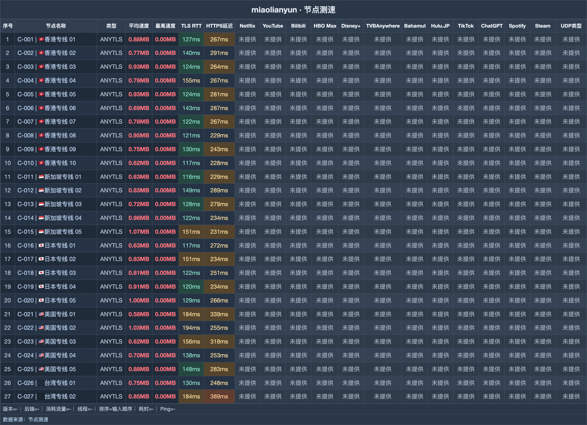

# 秒连云机场｜8 元月付 120G，160 Mbps 限速不随升档变化（2026-10-28 更新）

> **一句话评价：该轮 27/27 节点连通、全部 1 倍计费；先试 8 元档，再根据每月流量消耗决定是否升档。**
>
> 👉 **[官网注册](https://mly518.com/#/register?code=IDN5bnoG)** · 入门选 8 元 Air，先确认常用地区，再比较更长周期。

**适合：**

- 刚开始购买机场，更希望用小额月付完成试用。
- 不愿反复计算节点倍率，想导入订阅后逐个确认适配。
- 追剧和视频观看占比高，港新日历史延迟集中在 116–154ms。

**不适合：**

- 希望高级套餐带来更高限速，这里的上限统一为 160 Mbps。
- 尚未确定长期使用，却准备直接买年度活动商品。

| 选购项 | 内容 |
|---|---|
| 月付起点 | 8 元/月 120G |
| 节点记录 | 27 个，该轮全部连通 |
| 延迟中位 | 133 ms |
| 速度中位 | 6.7 MB/s |
| 最快平均速度 | 8.8 MB/s |
| 计费倍率 | 全部 1 倍 |
| 统一限速 | 160 Mbps |
| 协议 | AnyTLS |

**关于秒连云**：秒连云的英文名称写作 miaolianyun，AnyTLS 是其协议选择，流量产品包括周期付费、年度活动和不限时包。比较秒连云套餐可先看月付是否够用，流量和有效期才是转换购买方式的主要依据。

## 套餐

| 套餐名称 | 流量 | 设备 | 限速 | 一次付 | 月付 | 季付 | 半年 | 年付 | 两年 | 三年 |
|---|---|---|---|---|---|---|---|---|---|---|
| 150G/月 年付活动 | 150G | — | 160M | — | — | — | — | 118 | — | — |
| 220G/月 年付活动 | 220G | — | 160M | — | — | — | — | 168 | — | — |
| Air 120G | 120G | — | 160M | — | **8 元** | 24 | 48 | 96 | — | — |
| Base 220G | 220G | — | 160M | — | **15 元** | 45 | 90 | 180 | — | — |
| Pro 320G | 320G | — | 160M | — | **22 元** | 66 | 132 | 262 | — | — |
| Max 520G | 520G | — | 160M | — | **28 元** | 82 | 162 | 320 | — | — |
| 120G不限时 | 120G 一次性 | — | 160M | **38 元** | — | — | — | — | — | — |
| 320G不限时 | 320G 一次性 | — | 160M | **78 元** | — | — | — | — | — | — |
| 980G不限时 | 980G 一次性 | — | 160M | **198 元** | — | — | — | — | — | — |

> 所有套餐的限速都为 160 Mbps，升档不等于提速。150G/月和220G/月的年付活动是独立商品；月付每元流量约 15～19 GB/元，从 Pro 320G 到 Max 520G 计算。

## 测速

节点存档数为 **27**，该轮结果为 **27/27 连通**；最快平均速度读数 **8.8 MB/s**。这里先列高均速记录，图示位置见下图。

测试时间为 **2026-10-17 18:20–18:26**；环境为中国大陆家宽出口香港，每节点连测 **3 次取最优**。

| 节点名称 | 协议类型 | 延迟 | 完整请求 | 平均速度 | 最高速度 |
|---|---|---|---|---|---|
| 🇸🇬新加坡专线 05 | ANYTLS | 148ms | 229ms | **8.77 MB/s** | 11.29 MB/s |
| 🇺🇸美国专线 02 | ANYTLS | 198ms | 248ms | **8.44 MB/s** | 12.65 MB/s |
| 🇯🇵日本专线 05 | ANYTLS | 130ms | 262ms | **8.29 MB/s** | 12.72 MB/s |
| 🇸🇬新加坡专线 04 | ANYTLS | 123ms | 240ms | **8.11 MB/s** | 11.52 MB/s |
| 🇭🇰香港专线 08 | ANYTLS | 118ms | 234ms | **7.71 MB/s** | 11.13 MB/s |
| 🇭🇰香港专线 03 | ANYTLS | 123ms | 257ms | **7.67 MB/s** | 12.25 MB/s |
| 🇭🇰香港专线 05 | ANYTLS | 123ms | 276ms | **7.54 MB/s** | 11.02 MB/s |
| 🇯🇵日本专线 04 | ANYTLS | 123ms | 231ms | **7.42 MB/s** | 11.81 MB/s |

**地区分布**：总计 27 个节点，香港 10、新加坡 5、日本 5、美国 5、台湾 2。常用港新日的历史延迟为 116–154ms。

## 怎么选

- Air 120G 的 8 元月付适合起步；160 Mbps 对所有档位一致，用量接近额度再升级，不必为限速升档。
- 观看视频先试港新日，历史读数为 116–154ms。若 120G 消耗得很慢，可以比较 38 元不限时包：它相当于 4.75 个月月付费用，回到自己的使用频率再决定。
- 确定年度使用后再算活动档：150G/月为 118 元，比 Air 120G 年付多 22 元，月流量增加 30G。仍在试用的人先保留月付选择。

## 注册

👉 **[官网注册](https://mly518.com/#/register?code=IDN5bnoG)** · 入门选 8 元 Air，先确认常用地区，再比较更长周期。

*本文含推广链接，经此入口注册或购买，本站可能获得佣金。*

## 更新

- **2026-10-18** — 历史价格检查维持 AIR 8元/月；节点连通检查记录仍为 27/27。
- **2026-10-17** — 存档全节点复测结果是 27/27 连通，中位延迟 133ms，最快平均速度 8.8 MB/s。

---
*测速记录日期 2026-10-17 18:20–18:26，中国大陆家宽出口香港，每节点连测 3 次取最优。*
*价格与套餐以商家实时显示为准。*

展开相关搜索词

相关关键词：秒连云、miaolianyun、秒连云机场、秒连云套餐、秒连云官网、秒连云注册、秒连云入口、秒连云订阅、机场评测、机场套餐、机场推荐2026、科学上网、VPN订阅、clash配置、代理服务

